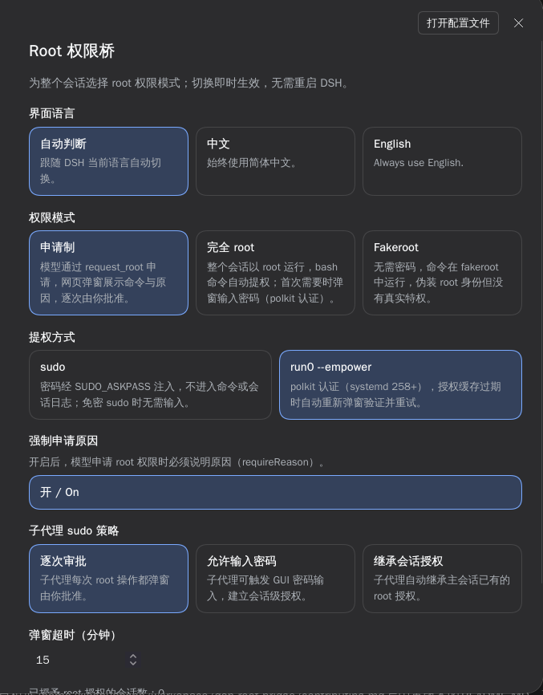
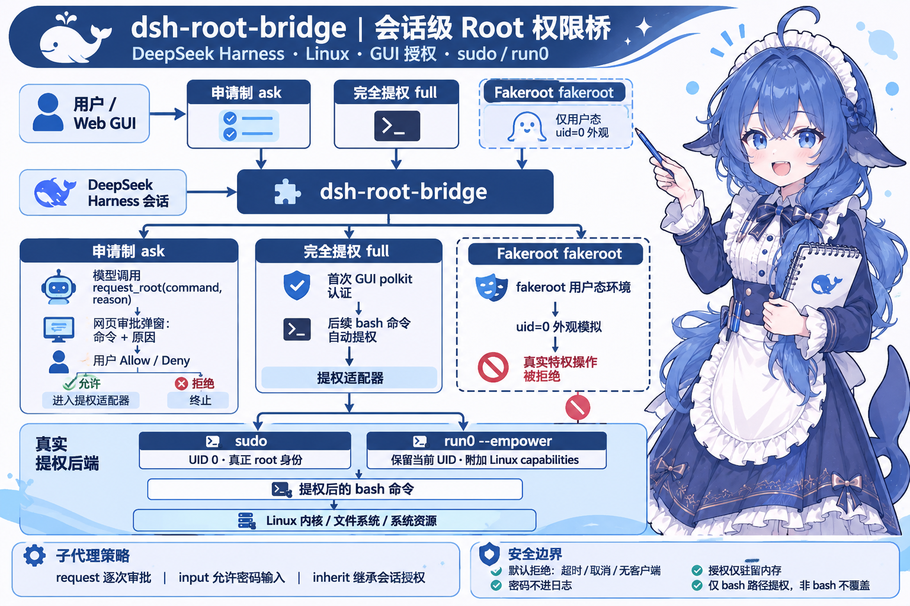

<div align="center">


# dsh-root-bridge · root 权限桥

**A session-level root privilege bridge for DeepSeek Harness — request approval, full root, and fakeroot modes with sudo / run0 escalation, all driven from the web GUI.**

**DeepSeek Harness 的会话级 root 权限桥：申请制 / 完全 root / Fakeroot 三种模式，sudo / run0 两种提权方式，审批与密码认证全在网页 GUI 内完成。**

[](https://www.npmjs.com/package/@xiaohuangbo/dsh-root-bridge)
[](LICENSE)
[](https://github.com/xiaohuangbo/dsh-root-bridge)

**Author / 作者**：[xiaohuangbo](https://github.com/xiaohuangbo)
**Repo / 仓库**：<https://github.com/xiaohuangbo/dsh-root-bridge>

</div>

---

<p align="center">
  
  <br/>
  <em>The settings page (<code>Settings → Root bridge</code>) with mode, escalation, subagent policy and language. / 设置面板里的「Root 权限」页：模式、提权方式、子代理策略与界面语言。</em>
</p>

<p align="center">
  

<p align="center">
  

## What is this / 这是什么

**English** — `dsh-root-bridge` gives every DeepSeek Harness session a configurable root-permission policy:

- **Ask mode** — the model requests root through a `request_root` tool call; a web popup shows the exact command and reason for you to approve or deny, one request at a time.
- **Full root mode** — the whole session runs elevated: every `bash` command is escalated automatically. The first escalation asks for your password in the GUI (polkit).
- **Fakeroot mode** — no password; commands run under `fakeroot` and only *appear* to be root, with no real privileges.

Escalation itself is pluggable — `sudo` (real uid 0) or `run0 --empower` (full Linux capabilities, keeps your uid). Delegated subagents get their own policy: ask each time, prompt for a password, or silently inherit the session grant.

**中文** — 为 DeepSeek Harness 的每个会话提供可配置的 root 权限策略：

- **申请 root 权限执行** — 模型通过 `request_root` 工具申请；网页弹窗展示**要执行的命令**和**申请原因**，由你逐次批准或拒绝。
- **完全 root 模式** — 整个会话以提权方式运行：`bash` 工具的所有命令自动提权。首次提权时在 GUI 弹窗输入密码（polkit）。
- **Fakeroot 模式** — 无需密码，命令在 `fakeroot` 中运行，仅**伪装** root 身份，没有真实特权。

提权方式可切换 —— `sudo`（真实 uid 0）或 `run0 --empower`（附加全部 Linux capabilities，保持你的 uid）。委托子代理另有独立策略：逐次审批 / 触发密码输入 / 静默继承会话授权。

## Permission modes / 权限模式

| Mode / 模式 | What it does / 行为 | Password / 密码 |
| --- | --- | --- |
| `ask` 申请制 | Every root action goes through a web approval popup showing the command and reason. / 每次 root 操作都经过网页审批弹窗（命令 + 原因）。 | First grant only / 仅首次授权 |
| `full` 完全 root | All `bash` commands are elevated automatically. / `bash` 命令全部自动提权。 | First grant only / 仅首次授权 |
| `fakeroot` Fakeroot | Commands run under `fakeroot` — `id` shows `uid=0`, files appear owned by root, but real privileged operations are refused. / 命令在 `fakeroot` 中运行，`id` 显示 0、文件看似 root 属主，但真实特权操作全部被拒。 | Never / 不需要 |

## Escalation methods / 提权方式

| | `sudo` | `run0 --empower` |
| --- | --- | --- |
| Process uid / 进程 uid | **0 (root)** | **1000 (your uid)** |
| Privilege source / 特权来源 | Full root identity / 完整 root 身份 | All Linux capabilities (`CapEff=000001ffffffffff`) |
| Read `/etc/shadow`, write `/root` / 读写敏感路径 | ✅ | ✅ (via `CAP_DAC_OVERRIDE`) |
| Password prompt / 是否要密码 | Yes; watch out for `pam_faillock` lockout / 是，且有 `pam_faillock` 锁号风险 | Not on this machine (`empower` group grants it via polkit) / 本机不需要（`empower` 组经 polkit 放行） |
| Files created by bash / 新建文件属主 | root | yourself / 你自己 |

> `run0 --empower` runs the command as **you** while attaching all capabilities — it is systemd's own “empower” semantics, not a uid switch. Both methods deliver real privileges; verified results are in [Verified behavior](#verified-behavior--实测结果).

## Features / 功能特性

- **Web approval popup / 网页审批弹窗** — shows the tool name, exact command, reason, escalation method and security warnings; Allow / Deny, Escape to cancel. / 展示工具名、完整命令、原因、提权方式与安全警告，可允许 / 拒绝，Esc 取消。
- **Password (polkit) popup / 密码（polkit）弹窗** — password entry with “show password” toggle; browser autofill is disabled so a stale saved password cannot silently fail authentication. / 带「显示密码」开关的密码输入框，并禁用浏览器自动填充，避免旧密码被静默填入。
- **Subagent policies / 子代理策略** — `request` (approve each request), `input` (allow password entry), `inherit` (reuse the session grant). / 逐次审批、允许输入密码、继承会话授权三种。
- **Language switcher / 界面语言切换** — `auto` (follows the DSH locale live), `zh`, or `en`, applied to every piece of plugin UI. / `auto` 实时跟随 DSH 语言，或强制中文 / English，作用于插件全部界面文案。
- **`request_root` tool / `request_root` 工具** — `command`, `reason`, `workdir`, `timeout_ms`; the reason is mandatory by default (`requireReason`). / 参数含命令、原因、工作目录、超时；默认强制要求原因（可关）。
- **Fail closed / 默认拒绝** — no live web client, user cancel, or timeout (default 15 min, `promptTimeoutMs`) all deny the request. / 无网页客户端、取消、超时（默认 15 分钟）一律拒绝。
- **Secrets never leak / 密码不落日志** — sudo passwords travel through a `0600` temp file + `SUDO_ASKPASS` helper, never on argv or in the session log; grants live in memory only and are wiped on plugin unload. / sudo 密码走 0600 临时文件 + `SUDO_ASKPASS`，不进命令行与会话日志；授权只存内存，插件卸载即清。
- **Anti-lockout guard / 防锁号保护** — before attempting sudo verification the plugin checks `pam_faillock` and refuses to try when failures already exist (3 wrong attempts lock the account for 10 minutes on this machine). / sudo 校验前先查 `pam_faillock`，已有失败记录就拒绝再试，避免把账号锁死。
- **Live switching / 实时切换** — every option is a `.volatile()` config field: mode, escalation, policy and language change instantly, no restart. / 全部字段都是 volatile：模式、提权方式、策略、语言即时生效，无需重启。

## Installation / 安装

**Requirements / 环境要求**：Linux, DeepSeek Harness `0.2.2-rc.1` (or later), and either `sudo` or `run0` (systemd ≥ 258 for `run0 --empower`). / Linux、DeepSeek Harness `0.2.2-rc.1` 及以上，并且具备 `sudo` 或 `run0`（`run0 --empower` 需要 systemd ≥ 258）。

### From npm (recommended) / 从 npm 安装（推荐）

**English** — the plugin is published as [`@xiaohuangbo/dsh-root-bridge`](https://www.npmjs.com/package/@xiaohuangbo/dsh-root-bridge). Add it to the current profile with the plugin manager CLI:

```bash
dsh plugin add @xiaohuangbo/dsh-root-bridge
```

Pin an exact version when you need reproducibility / 需要固定版本时：

```bash
dsh plugin add @xiaohuangbo/dsh-root-bridge@1.0.0
```

Prebuilt npm installs skip the build-approval step, so this is the smoothest path. / npm 预构建安装无需构建授权，是最省事的路径。

**中文** — 插件已发布为 [`@xiaohuangbo/dsh-root-bridge`](https://www.npmjs.com/package/@xiaohuangbo/dsh-root-bridge)，用插件管理器把它装进当前 profile：

```bash
dsh plugin add @xiaohuangbo/dsh-root-bridge
```

### Other ways / 其他安装方式

| Way / 方式 | Command / 操作 |
| --- | --- |
| From GitHub / 从 GitHub | `dsh plugin add https://github.com/xiaohuangbo/dsh-root-bridge` |
| Local bundle directory / 本地目录 | GUI 插件管理 → 「本地目录 / bundle 安装」→ 指向本仓库（自带 `dsh.bundle` 与 `cordis.patch.yml`） |
| Manual row / 手动加行 | 在 profile 的 `cordis.patch.yml` 中插入下方配置块 / insert the block below into the profile `cordis.patch.yml` |

```yaml
- insert:
    - id: dsh-root-bridge
      name: '@xiaohuangbo/dsh-root-bridge'
      config: {}
```

After installation, reload the web page once and the plugin's settings section (`Settings → Root bridge`) plus the composer-dock `Root ▾` chip appear. / 安装后刷新一次网页，即可在设置面板看到「Root 权限」页、在输入框底栏看到 `Root ▾` 芯片。

## Usage / 使用

**English** — three places control the plugin:

1. **Settings → Root bridge** — full form: language, permission mode, escalation, require-reason, subagent policy, popup timeout, live grant count, and the security warnings.
2. **Composer bottom bar** — a collapsed `Root ▾` chip next to the permission chip: click to open the three-mode menu, click an option to switch instantly.
3. **Config file** — in the profile `cordis.patch.yml`, add a `config` block to the `dsh-root-bridge` row (see [Configuration](#configuration--配置)).

The model side is one tool:

- **`request_root`** — asks to run one bash command as root. In ask mode it opens the approval popup; in full mode it answers “bash is already elevated”; in fakeroot mode it explains that no real privilege exists.

**中文** — 三个入口控制插件：

1. **设置 → Root 权限** — 完整表单：界面语言、权限模式、提权方式、强制原因、子代理策略、弹窗超时、当前授权会话数与安全警告。
2. **输入框底栏** — 权限芯片旁的折叠 `Root ▾` 芯片：点开是三选一菜单，点击即切换、立即生效。
3. **配置文件** — 在 profile 的 `cordis.patch.yml` 中给 `dsh-root-bridge` 行加 `config`（见[配置](#configuration--配置)）。

模型侧只有一个工具：

- **`request_root`** — 申请以 root 执行一条 bash 命令。申请制下弹审批窗；完全 root 下提示“bash 已自动提权”；fakeroot 下说明没有真实特权。

## Configuration / 配置

All fields are volatile — changes apply immediately. / 全部字段为 volatile，改动即时生效。

| Field / 字段 | Values / 取值 | Default / 默认值 | Meaning / 含义 |
| --- | --- | --- | --- |
| `mode` | `ask` \| `full` \| `fakeroot` | `ask` | Permission mode / 权限管理模式 |
| `escalation` | `sudo` \| `run0` | `sudo` | Escalation method / 提权方式 |
| `requireReason` | `true` \| `false` | `true` | Require a reason on every root request / 申请时强制要求原因 |
| `subagentPolicy` | `request` \| `input` \| `inherit` | `request` | Subagent sudo policy / 子代理策略 |
| `promptTimeoutMs` | number / 数字 | `900000` | Approval / password popup timeout in ms / 弹窗超时（毫秒） |
| `language` | `auto` \| `zh` \| `en` | `auto` | Plugin UI language / 插件界面语言 |

```yaml
# profile cordis.patch.yml
- id: dsh-root-bridge
  name: '@xiaohuangbo/dsh-root-bridge'
  config:
    mode: ask
    escalation: run0
    subagentPolicy: request
    language: auto
```

## Verified behavior / 实测结果

Tested on Arch-based Linux, systemd 262, DSH 0.2.2-rc.1. / 实测环境：Arch 系 Linux、systemd 262、DSH 0.2.2-rc.1。

| Mode / 模式 | Escalation / 提权方式 | Popups / 弹窗 | Result / 结果 |
| --- | --- | --- | --- |
| ask / 申请制 | sudo | approval + password / 审批 + 密码 | ✅ `uid=0`, real root / 真 root |
| ask / 申请制 | run0 | approval only / 仅审批 | ✅ full capabilities, real privilege / 全 capabilities 真特权 |
| full / 完全 root | sudo | first-time password / 仅首次密码 | ✅ every bash auto-elevated to uid 0 |
| full / 完全 root | run0 | none / 无 | ✅ every bash auto-elevated (uid 1000 + full caps, parent = systemd) |
| fakeroot | — | none / 无 | ✅ cosmetic only — real privileged operations all refused / 仅伪装，真实操作全拒 |

Subagent policy `request` verified: a delegated subagent triggers its own approval popup and does **not** reuse the main session's existing grant. / 已实测 `request` 策略：子代理独立弹审批窗，不复用主会话已有授权。

## Security / 安全说明

1. Respect other people's privacy. / 尊重他人的隐私。
2. Think twice before entering a command. / 输入命令前请三思。
3. With great power comes great responsibility. / 能力越大，责任越大。

- Session grants live in memory only — a Harness restart requires re-authentication. / 会话级授权只存内存，Harness 重启后需重新验证。
- Passwords are never written to the session log or configuration. / 密码不写入会话日志与配置。

## Development / 开发

```bash
npm test
```

Six tests, all passing / 6 个测试全部通过：

- `test/config-getters.test.mjs` — config getters must read `this.config` (plain values, volatile `{ get() }` wrappers, empty config); regression against the self-recursive getter that once crashed boot with “Maximum call stack size exceeded”. / 配置 getter 必须读 `this.config`（普通值 / volatile 包装 / 空配置），防自递归 getter 回归。
- `test/ask-flow.test.mjs` — `askUser → status().pending → decide/submitPassword → settle` for approval, password and deny paths. / 审批、密码、拒绝三条链路的闭环测试。
- `test/client-contract.test.mjs` — client contribution descriptors satisfy the real typert registry validators; the previously shipped broken descriptor shape must be rejected; a failing step must degrade only that step. / 客户端描述符必须通过真实校验；旧错误形状必须被拒绝；单步失败只降级该步。
- `test/client-integration.test.mjs` — activates the client half in a real Cordis context with the shipped `@deepseek-ai/dsh-typert-registry` and `@deepseek-ai/dsh-api-gateway` bundles, verifying namespace mount and real RPC wiring. / 用真实 typert 注册表与网关 bundle 激活客户端半边，验证命名空间与真实 RPC。

Implementation notes (read before touching this code) / 实现要点（改代码前必读）：

<details>
<summary>Expand / 展开</summary>

1. **No Host→Client forwarded events** — the gateway's `registerRemoteEvents` is single-source (`if (this.remoteEvents !== undefined) throw`) and `@deepseek-ai/dsh-api-remotes` owns it at boot. Approval therefore rides `status().pending` + a 600 ms client poll, answered via the `decide()` / `submitPassword()` Remote methods. / 网关远程事件源是单源的，已被 api-remotes 占用；审批改为 `status().pending` + 客户端 600ms 轮询 + Remote 方法应答。
2. **Never combine `-n` with `-A` for sudo** — `-n` means “never prompt”, which also disables `SUDO_ASKPASS`; any password-protected account then fails verification unconditionally. / `-n` 连 askpass 都不调用，与 `-A` 互斥，密码校验必失败。
3. **`pam_faillock` trap** — one sudo verification retries 3 times internally; a wrong password fills the deny threshold instantly and locks the account for 10 minutes (correct passwords then fail too). The plugin refuses to try when failures already exist; unlock with `faillock --reset`. / sudo 一次校验内部重试 3 次，错密码立刻锁号 10 分钟；插件会在已有失败记录时拒绝再试，手动解锁用 `faillock --reset`。
4. **Tool `output.render` must return content blocks** — `() => [{ type: 'text', text }]`; a bare string crashes downstream `content.some`. / render 必须返回内容块数组，裸字符串会让下游崩溃。
5. **Avoid `ctx.shell.execute`** — in this composition it requires a `sandboxPolicy` on the request (only the bash tool has one). The plugin spawns `bash -c` directly; elevated commands are isolated by sudo/run0 anyway. / 该服务要求 sandboxPolicy（仅 bash 工具持有），插件改为直接 spawn。
6. **Use `ctx.get('shell')`, not `ctx.shell`** — direct property access throws `cannot get property "shell" without inject`. / 直接点属性会抛 cordis 注入错误，用 `ctx.get`。
7. **Reset the modal's `busy` on every new request** — otherwise, after one answered request, the next popup's buttons render `disabled` (“clicking does nothing until refresh”). / busy 必须在每次新请求时重置，否则下一个弹窗按钮全是 disabled。
8. **Never use `this.ctx.fiber.entry` to find the config row** — it pointed at the **typert-gateway** entry here, silently writing mode changes into the gateway config. Resolve your own entry from `configEditor.entries()` by id/module name instead. / 它会指向 typert-gateway 条目，把模式写进网关配置；必须按 id/模块名从 `configEditor.entries()` 里找自己的行。
9. **Host hot-reload requires a new file name** — Node's ESM cache and the cached `package.json` are keyed by path; after editing, deploy under a new file name (currently `svc14.js`), or restart `dsh web`. Note the side effect: renaming invalidates the saved profile override row, so the plugin config resets once after a rename. / ESM 缓存按路径生效，改宿主代码要换新文件名（当前 `svc14.js`）；注意换名会使已保存的配置覆盖行失配一次。
10. **run0 on systemd 262** — no `--wait` flag; never probe with `--no-ask-password` (polkit refuses interactive auth outright — probe with plain `run0 --empower true`); `script` needs `-e` to forward the child exit code; `--empower` means “capabilities for the current user”, not a uid switch. / systemd 262 无 `--wait`；探测别用 `--no-ask-password`；`script` 要 `-e`；`--empower` 语义是给能力而非切 uid。

</details>

## Known limitations / 已知限制

- If sudoers sets `Defaults requiretty`, non-interactive sudo may be refused — use passwordless sudo or `run0`. / sudoers 若配了 `Defaults requiretty`，非交互 sudo 可能被拒，请改用免密 sudo 或 run0。
- `run0 --empower` keeps your uid; files it creates are still owned by you. / `run0 --empower` 保持你的 uid，创建的文件仍归你所有。
- fakeroot is user-space fakery — kernel-level operations (mount, real chown, ping) stay restricted. / fakeroot 只是用户态伪装，需要内核权限的操作依旧受限。
- Linux only; non-`bash` execution paths (pwsh, terminal tools) are not escalated. / 仅 Linux；`bash` 之外的执行路径（pwsh、终端工具）不在提权范围内。

## License / 许可

[GNU General Public License v3.0](LICENSE) © 2026 [xiaohuangbo](https://github.com/xiaohuangbo)

This program is free software: you can redistribute it and/or modify it under the terms of the GNU General Public License as published by the Free Software Foundation, **version 3** of the License. It is distributed in the hope that it will be useful, but **without any warranty**; without even the implied warranty of merchantability or fitness for a particular purpose. See the [GNU General Public License](LICENSE) for more details.

本程序为自由软件：你可以依据自由软件基金会发布的 GNU 通用公共许可证**第三版**的条款重新发布或修改它。本程序希望有用，但**不提供任何担保**，甚至不提供适销性或特定用途适用性的默示担保。详见 [GNU 通用公共许可证](LICENSE)。
